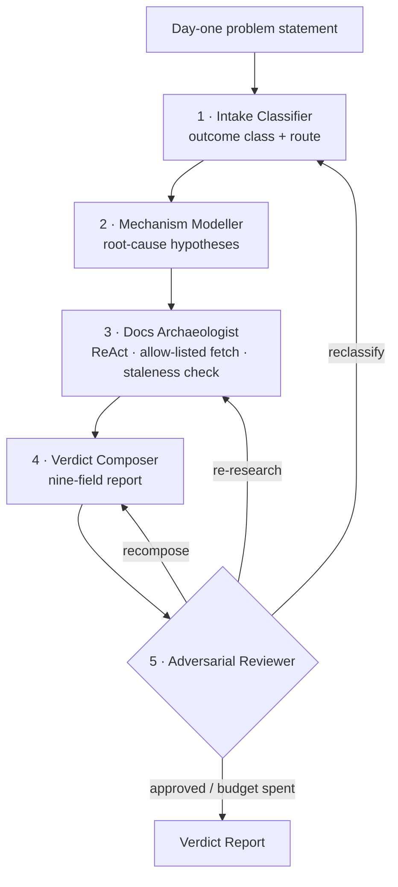

# Pit Box: the Verdict Engine

> ***Box, box, box.*** Bring in a stuck Microsoft problem mid-race, get a **verdict in minutes**, and go back out. Without it, the same answer takes 5–10 weeks through a support case.

A multi-agent crew that takes a **day-one problem statement** about a Microsoft estate (Purview, Defender, Intune, Entra, Azure) and returns a **Verdict Report**: the outcome class, the correct escalation route, a mechanism-level root cause, **citations it actually fetched**, and what the fix *won't* cover.

> 🔒 **Showcase repo.** Pit Box is a commercial product. The source is private and this page explains the design. [Get in touch](https://github.com/mjha-arya) for a demo.

---

## The idea: predict, then verify

Most AI assistants search, then summarise. Pit Box **predicts the verdict from product architecture first**, meaning what the product structurally *cannot* do. Then it goes and proves or refutes that prediction with dated, fetched evidence.

## Example input

> *"Endpoint DLP is not blocking uploads of sensitive files from browsers to personal cloud storage, but blocks the same files on USB. Purview E5, policies deployed a week ago."*

The output says which of six terminal outcomes this is (including ***do not raise a case***), who to route it to, the mechanism behind it, and evidence for every claim.

## Built to be trusted

| Guarantee | How |
|---|---|
| **No invented citations** | Every successful `fetch_page` is recorded. Citations that weren't fetched are downgraded automatically |
| **Evidence tiers** | T0 = architecture hypothesis, never presented as an answer. T1 = doc-cited and dated, the minimum for a verdict |
| **Staleness is a field** | Every citation carries `published_or_updated` + `staleness_ok`. A correct-in-2022 answer gets flagged |
| **Weak reports stay weak** | Confidence is capped without fresh T1 evidence. `WEAK EVIDENCE` banner, exit code `2` |
| **The reviewer can force a real fix** | Re-research or reclassify, not just rewrite the prose. Bounded at 2 loops |
| **Structured handoffs** | Every inter-agent message is a validated pydantic model, so there's no free-text parsing |
| **Acceptance gate** | A backtest replays founding cases against their known endings. It ships only at 4/4 |

## Stack
LangGraph · Claude (Anthropic SDK, structured tool-use output) · pydantic · ReAct research agent with allow-listed fetch

## Roadmap
- Tenant evidence via Graph/KQL over MCP (tier T2) and lower-environment reproduction (T3)
- A Case Historian that reads a limitation ledger and a closed-case archive
- A Route & Case Operator that drafts the support case, the account-manager brief and watch items

---
Built by **Manish Jha**: 10 years in Microsoft security operations (KPMG, Okta, enterprise financial services), now building secure, provable AI agents. [Profile →](https://github.com/mjha-arya)
